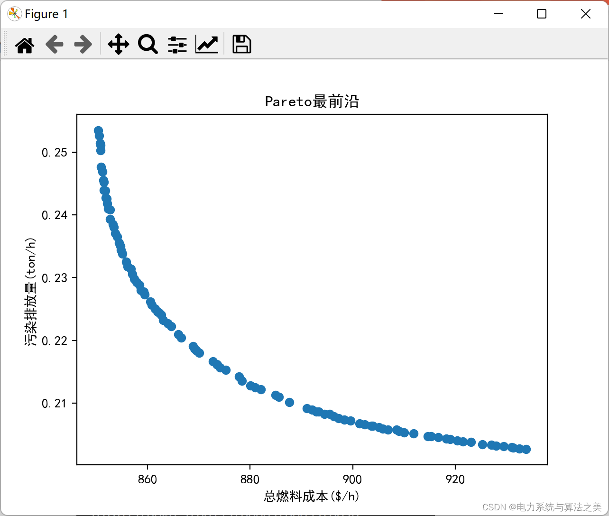
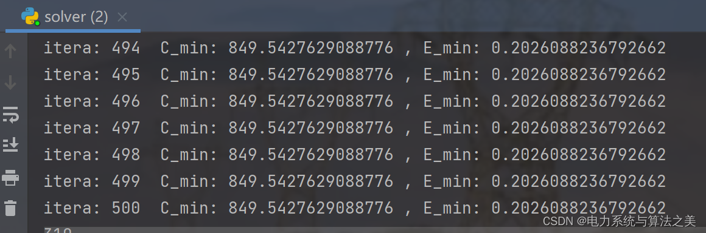
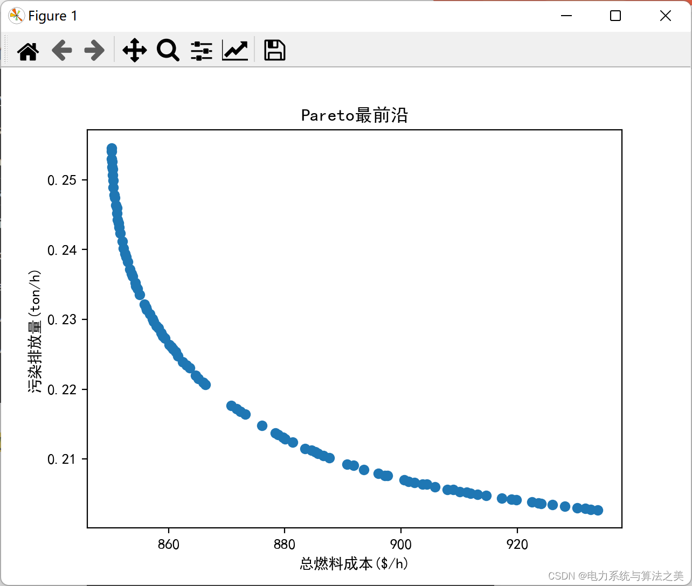
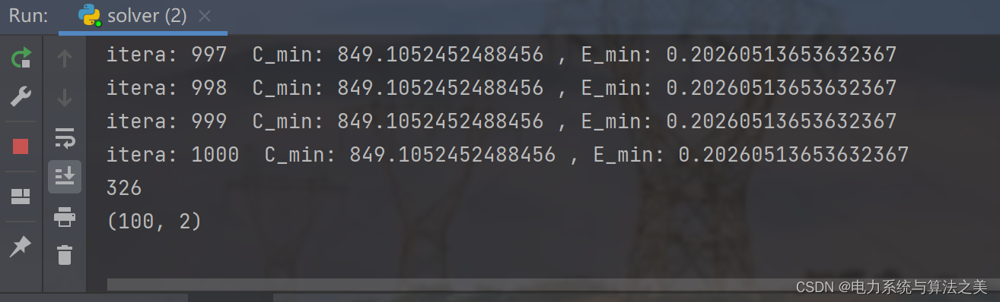
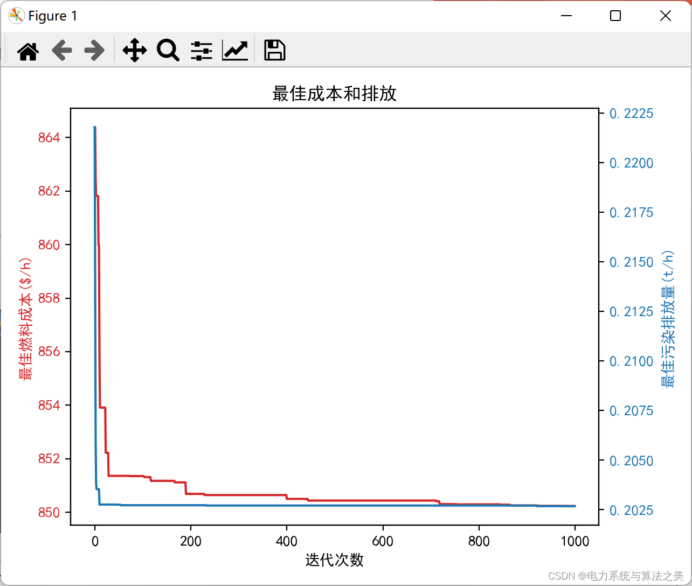

# Improved Multi-Objective Differential Evolution Algorithm in the Application of Power System Environmental Economic Dispatch (Python Code Implementation)

​  
The improved multi-objective differential evolution algorithm can not only be applied to the environmental economic dispatch of power systems, but it is still applicable to other multi-objective functions and constraints. The main goal is to effectively utilize this tool in other multi-objective classic problems, and then you can write a journal paper.
The following is the result of the execution:
Editor
Editor
Iteration 1000 times:
Editor
Editor
Editor
​  

## Images

<!-- PAYMENT_BLOCK -->

## Get this dataset

- Payment link (Stripe): [Buy now](https://buy.stripe.com/3cs8yP7sY87d0vu9AB)
- Payment QR code: 

<!-- /PAYMENT_BLOCK -->
